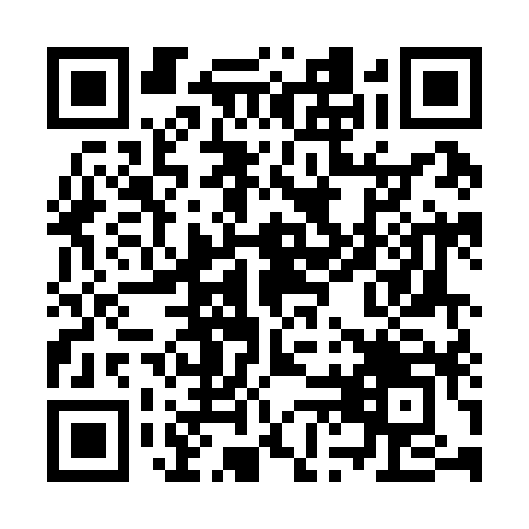
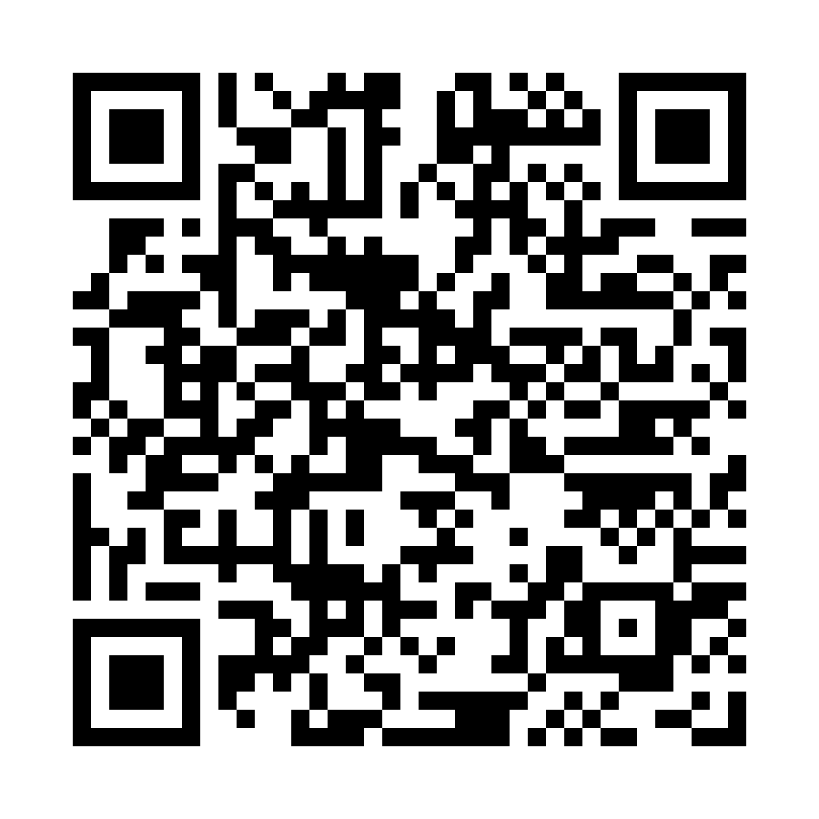
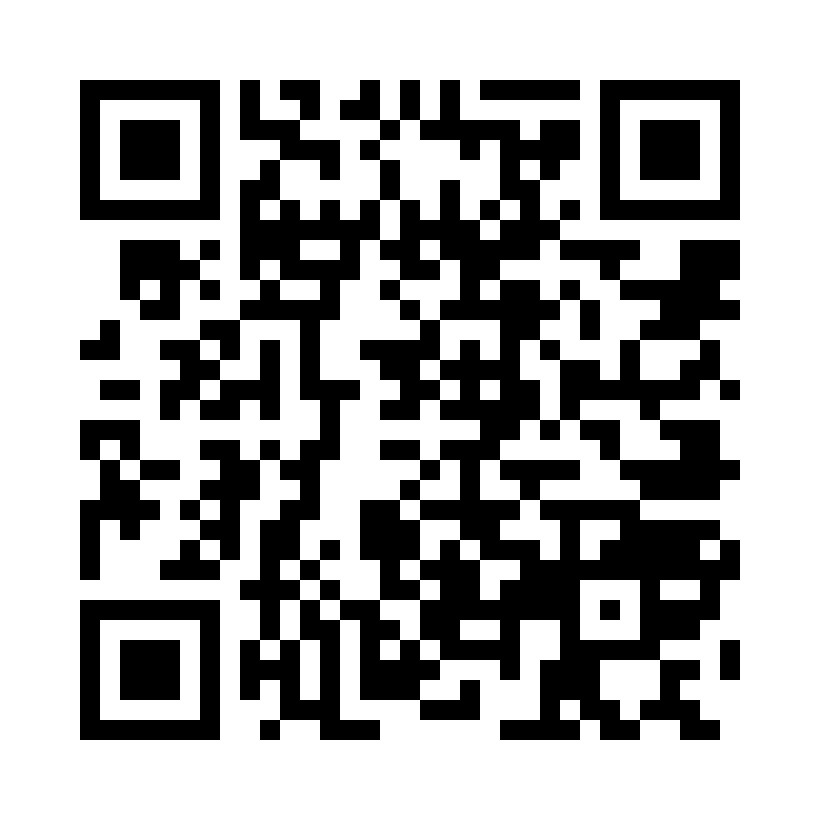
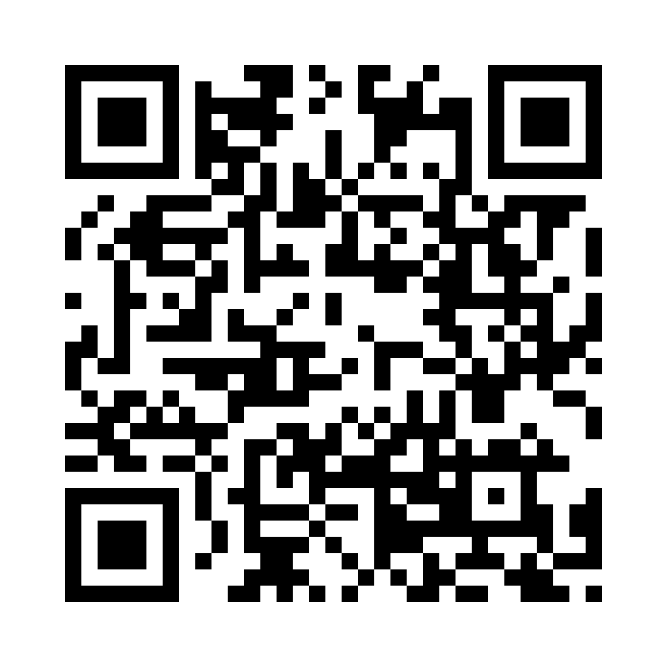

<p align="center">
  <a href="./README.md">English</a> · Español
</p>

<p align="center">
  <a href="https://cybergems.org/apps/cyberclock/">
    
  </a>
</p>

<p align="center">
  <a href="https://github.com/CyberGems/CyberClock/releases/latest"></a>
  &nbsp;<a href="https://github.com/CyberGems/CyberClock/releases"></a>
</p>

<p align="center">
  &nbsp;
  &nbsp;
  &nbsp;
  <a href="https://github.com/CyberGems/CyberClock/wiki"></a>&nbsp;
  <a href="https://github.com/CyberGems/CyberClock/releases"></a>
</p>

---

<div align="center">

### Tu reloj, calendario, temporizador, cronómetro y widgets flotantes, juntos en una sola app ligera para Windows

</div>

---

## 📑 Table of Contents

- [👋 Introducción](#-introducción)
- [🖼️ Capturas](#️-capturas)
- [🕐 ¿Por qué CyberClock?](#-por-qué-cyberclock)
- [✨ Funciones principales](#-funciones-principales)
- [⬇️ Instalación](#️-instalación)
- [🧭 Cómo usar la app](#-cómo-usar-la-app)
- [🛠️ Stack tecnológico y arquitectura](#️-stack-tecnológico-y-arquitectura)
- [⌨️ Atajos de teclado](#️-atajos-de-teclado)
- [❤️ Donar](#️-donar)
- [📄 Licencia](#-licencia)
- [❓ Preguntas frecuentes](#-preguntas-frecuentes)
- [🔗 Ver también](#-ver-también)

<details>
<summary><strong>🔗 Related links (outside this README)</strong></summary>

- 🌐 [CyberClock en la web](https://cybergems.org/apps/cyberclock/) — resumen, descarga y guía de SmartScreen
- 📚 [Documentación y FAQ — Wiki](https://github.com/CyberGems/CyberClock/wiki) — solución de problemas y guías detalladas
- 💾 [Releases](https://github.com/CyberGems/CyberClock/releases) — instaladores, versiones portátiles y changelog
- 🟣 [Suite CyberGems](https://github.com/CyberGems) — todas las apps de código abierto

</details>

---

## 👋 Introducción

El tiempo en un escritorio suele llegar por partes: el reloj de la barra de tareas, un calendario aparte, el temporizador del móvil, un cronómetro que nunca recuerdas dónde pusiste. CyberClock los reúne en una sola ventana —esferas analógicas y digitales con 10 diseños, calendario completo con agenda y notas del día, temporizador de cuenta atrás, cronómetro de precisión y alarmas, además de un reloj parlante opcional que anuncia la hora y lee las alarmas en voz alta— y deja que las herramientas principales se desprendan como su propio widget flotante: reloj, calendario, temporizador, cronómetro o sesión de relajación, cada uno con su propio diseño y siempre visible sobre tus demás ventanas. El Modo Mini reduce toda la app a una barra compacta con 20 skins, un módulo de bienestar añade paisajes sonoros grabados, y cada ajuste de acento, tamaño y transparencia se queda en local, con copias automáticas de tus alarmas, notas y preferencias en la carpeta que elijas. Construido con **Tauri v2** y **Rust**.

*Gratuito y de código abierto: sin anuncios, sin rastreo y sin recogida de datos. Solo disfrútalo.*

---

<!-- Capturas: pendiente de la galería bilingüe ES/EN del plan en https://github.com/CyberGems/CyberGems.github.io/blob/main/docs/screenshots.md — sustituir la cita, conservar este título y su entrada en el índice. -->

## 🖼️ Capturas

> Próximamente...

---

## 🕐 ¿Por qué CyberClock?

La mayoría de las apps de reloj te muestran la hora y nada más. CyberClock transforma tu escritorio en un **centro de productividad y bienestar**: medición elegante del tiempo, herramientas de precisión para el trabajo y el estudio, y un módulo de relajación para desconectar. Todo empaquetado en una app Tauri ligera y con rendimiento nativo.

| Necesidad | Solución |
|---|---|
| Medición elegante del tiempo | Reloj analógico renderizado en canvas + pantalla digital con 10 diseños de esfera seleccionables |
| Mantente organizado | Calendario completo con agenda, notas por día, estadísticas, fase lunar y calendario flotante |
| Mide tu trabajo | Temporizador, cronómetro de precisión y widgets flotantes de escritorio persistentes |
| Relájate y concéntrate | 6 paisajes sonoros ambientales grabados con mezcla de capas |
| Escucha la hora | Reloj parlante opcional con voces de Windows, tres estilos de anuncio, horas de silencio y lectura de alarmas |
| Ahorra espacio en pantalla | Modo Mini: barra de reloj compacta siempre visible con 20 skins únicas |
| No pierdas tus alarmas | Copias JSON automáticas en cada inicio y antes de cada restauración, con carpeta propia y retención rotativa |
| Hazlo tuyo | 10 tintes de acento, escala de tamaño de texto, controles de transparencia, multi-monitor |

---

## ✨ Funciones principales

### 🕐 Reloj y calendario
- **Reloj analógico:** renderizado en canvas con animaciones suaves y acentos neón; puede ocultarse en el modo completo para dar todo el ancho al calendario
- **Diez diseños de esfera:** Clásica, Minimalista, Segmentos, HUD, Cuántica, Cronógrafo, Matriz Hex, Núcleo Reactor, Circuito PCB y la esfera multicolor Corona de Gemas
- **Pantalla digital:** fuente Space Grotesk con celdas de dígitos de ancho fijo (12H / 24H)
- **Reloj ampliado:** haz clic en el reloj o la fecha de la barra de título para llenar toda la pantalla con el reloj digital: saludo, barra de progreso de segundos, próxima alarma y el nombre editable de la esfera (haz clic para cambiarlo). Incluye su propio botón de Modo Mini y muestra siempre los segundos; Esc, la flecha de regreso o un clic en el fondo vuelven al panel, y su estado abierto se recuerda entre reinicios
- **Calendario completo:** vista mensual con agenda, notas por día y estadísticas
- **Inteligencia de fechas:** día del año, semana ISO, días restantes, fase lunar
- **Notas del día:** adjunta notas a fechas concretas con un editor en ventana
- **Widget de calendario flotante:** calendario de escritorio compacto e independiente con 10 skins ciberpunk/neón, rotación automática diaria, ventana emergente de selección de fecha, vistas previas rápidas de notas, navegación multi-mes y menú contextual propio
- **Widget de reloj analógico flotante:** reloj analógico de escritorio flotante con diseños de esfera personalizables, siempre visible y con visibilidad en la barra de tareas

### ⏱️ Temporizador y cronómetro
- **Temporizador de cuenta regresiva:** pantalla digital grande con milisegundos, botones de preajuste, barra de progreso visual y estado de advertencia
- **Cronómetro:** medición de precisión con registro de vueltas, delta frente al promedio, resaltado de la mejor/peor vuelta y exportación al portapapeles
- **Widgets flotantes de escritorio:** abre ventanas compactas independientes de temporizador y cronómetro con soporte de varias ranuras; los widgets se recuerdan y se restauran entre reinicios de la app
- **Skins independientes y renombrado:** elige skins distintas por tipo de widget (Reloj Mini, Temporizador, Cronómetro) y personaliza los títulos de los widgets
- **Lanzamiento entre widgets:** crea fácilmente temporizadores, cronómetros, relojes analógicos, calendarios o una sesión de relajación desde el menú contextual de cualquier widget activo
- **Preajustes del temporizador flotante:** suma 30s, 1m, 5m, 10m o 15m a la duración armada sin iniciar la cuenta regresiva (se puede ocultar desde el menú contextual)
- **Dígitos en reposo y pantalla ampliada:** dígitos de contador mejorados en todas las skins, con el estado a cero atenuado hasta que se arma un tiempo

### 🧘 Módulo de relajación
- **6 paisajes sonoros ambientales:** Noche, Bosque, Espacio Exterior, Océano, Lluvia, Chimenea
- **Audio ambiental grabado:** seis paisajes sonoros reales reproducidos con la Web Audio API, con síntesis procedural como respaldo si faltan los archivos
- **Pausa real:** pausar congela el audio y el tiempo de sesión; reanudar continúa exactamente donde lo dejaste (la barra espaciadora alterna reproducir/pausar)
- **Mezcla ambiental:** Usa el **+** de una tarjeta para añadir esa pista a la mezcla (Lluvia + Chimenea, Océano + Espacio Exterior…). Pulsa la tarjeta para reproducirla sola. Ajusta el volumen de cada capa o quítala desde el reproductor. CyberClock recuerda la mezcla y el volumen de cada capa al reabrir la app. Usa Reanudar en Relax para volver a escucharla. Volumen general controla toda la mezcla
- **Flujo Zen:** reproducción aleatoria de todas las pistas con un clic
- **Parada Automática suave:** el temporizador de parada automática funde el audio suavemente durante el último minuto
- **Visualizador de espectro de audio:** visualización de frecuencias en tiempo real
- **Widget de relajación flotante:** sesión compacta de escritorio con el nombre de la pista, un botón grande para reproducir o pausar, controles de siguiente y aleatorio, estado de reproducción, las capas activas, la cuenta regresiva de Parada Automática, un espectro pequeño y 10 diseños. El widget controla la sesión principal de Relax y puede reanudar la mezcla guardada con el modo completo oculto
- **Tiempo de sesión:** tiempo transcurrido y cuenta regresiva de Parada Automática junto a la pista y los controles
- **Programador automático:** programa horarios de reproducción automática
- **Aviso de silencio:** un banner discreto con un botón de Activar con un clic si el audio global está silenciado

### 📌 Modo Mini
- **20 skins únicas:** diseños distintos para la barra de reloj compacta, cada uno con sus propias dimensiones y zoom opcional (0.5×–4×)
- **Nota emergente nativa:** ventana emergente al pasar el cursor que muestra notas del calendario y alarmas activas, con creación, edición y eliminación de notas directamente en el escritorio
- **Herramientas flotantes con skin:** las ventanas de temporizador y cronómetro reutilizan los diseños seleccionados con disposiciones dimensionadas para sus controles
- **Zoom individual por widget:** controles de escala independientes para ajustar el tamaño de cada herramienta flotante por separado
- **Ocultación automática en pantalla completa multi-monitor:** el reloj mini y los widgets flotantes se ocultan solos ante aplicaciones o juegos en pantalla completa en cualquier monitor conectado
- **Controles de transparencia:** deslizadores de opacidad del fondo y del contenido
- **Siempre visible:** mantiene el reloj visible sobre otras ventanas
- **Bloqueo de posición:** bloqueo contextual por widget (Reloj Mini, Temporizadores, Cronómetros, Reloj Analógico, Calendario, Relajación)
- **Desvanecido automático (atenuación por inactividad):** desvanecido opcional en reposo (70%, 50%, 30%, 15%) que restaura la opacidad completa al instante al pasar el cursor
- **Mostrar Fecha y Mostrar Segundos:** interruptores en el menú del Modo Mini; ocultar la fecha acorta la barra (ambas vuelven al pasar el cursor)
- **Avance del Día:** línea opcional en el borde inferior de la barra mini. Al pasar el cursor muestra cuánto del día ha pasado, en porcentaje
- **Clic a través:** deja que los clics del ratón atraviesen el reloj mini y los widgets flotantes (se alterna desde los menús contextuales, la bandeja o desde Configuración)

### 🔔 Alarmas y campanadas
- **Locutor de hora por voz (Reloj Parlante):** dice la hora una sola vez cada 15, 30 o 60 minutos, con voces de Windows seleccionables, estilo personalizable (Natural, Cyber/Táctico, Conciso), timbre suave opcional, horas de silencio, lectura de alarmas en voz alta opcional (interruptor global o por alarma) y acceso directo para instalar voces de Windows
- **Campanadas horarias y alertas:** campanadas de cuarto de hora (:15, :30, :45), media hora (:30) y en punto (:00) con control de volumen dedicado, vistas previas de prueba instantánea y ventana de silencio
- **Volumen de campanadas dedicado:** deslizador de volumen independiente para las campanadas horarias y las alertas de intervalo, que conserva el volumen maestro de alarma
- **6 sonidos de campanada:** Campana de Cristal, Timbre Suave, Arpegio Neón, Gong Zen, Aurora y Caja de Música para las campanadas horarias
- **Campanada personalizada:** carga tu propio archivo de audio para un intervalo de campanada
- **Ventana de horario:** silencia las campanadas durante horas concretas
- **Alarmas:** vista de Alarmas con preajustes, tarjetas y diseñador. Elige glifos visuales de un catálogo de 24 iconos, configura repetición de sonido con preajustes de pausa (30s, 1m, 2m…), o programa una vez, diario, entre semana, fines de semana o días personalizados. Las alarmas nuevas empiezan en Sin sonido, con veinte tonos sintetizados o tu propio MP3 o WAV. Posponer muestra su demora, y al sonar la alarma se restaura y enfoca el Modo Completo. Eliminar después de la alarma la quita al cerrar el aviso. Duplicar copia una alarma, y las plantillas guardan una configuración sin programarla

### 🖥️ Integración con escritorio
- **Bandeja del sistema:** menú emergente HTML personalizado con navegación deslizante, anclado al icono de la bandeja (con compatibilidad para barras de tareas verticales) y con submenú de Ayuda completo, incluido un acceso al diálogo de fecha y hora de Windows. Un clic izquierdo trae el reloj delante y no lo oculta. El menú dice si está en pantalla, y lista Modo Completo y Modo Mini juntos, con el actual marcado. Nueva Alarma abre el diseñador en Modo Completo
- **Opciones de minimizar y cerrar:** botón dedicado para minimizar en la barra de título, comportamiento al cerrar configurable (minimizar a la bandeja, pasar a Modo Mini o salir) con diálogo de confirmación en el primer cierre, botón de cierre directo y descarte desde el fondo
- **Atajo global:** muestra u oculta el reloj desde cualquier lugar (Alt+Shift+C por defecto; graba tu propia combinación o desactívala en Configuración)
- **Monitor automático:** el modo completo se abre en el monitor donde está el ratón (estilo CyberLauncher), o fíjalo a una pantalla preferida
- **Modo completo en el área de trabajo:** el modo completo llena el área de trabajo de la pantalla seleccionada y queda fijado allí: se respetan barras de tareas ancladas en cualquier borde, y el arrastre o el doble clic de maximizar/restaurar no pueden romper el diseño
- **Guardián de precisión del reloj:** comprobación periódica de desfase NTP mostrada en Configuración, con notificación de Windows cuando la hora del sistema se desvía más de un minuto
- **Soporte multi-monitor:** elige en qué pantalla aparece CyberClock; los cambios de pantalla se detectan y la ventana se reposiciona sola
- **Inicio automático con Windows:** inicio basado en el registro, ofrecido como opción en el propio instalador y sincronizado con el interruptor de Configuración (la app reconcilia ambos en cada arranque)
- **Actualizaciones automáticas:** actualizador integrado de Tauri con GitHub Releases y notas de la versión bilingües en la app
- **Interfaz bilingüe:** interfaz completa en inglés y español
- **Respaldo y Datos:** exporta o importa alarmas, notas, temporizadores y preferencias como JSON; copias automáticas rotatorias en cada inicio y antes de cada restauración, con carpeta propia y número de copias a conservar; restaura cualquier copia (antes se guarda una instantánea de seguridad), abre la carpeta de datos local o restablece los valores de fábrica desde una pestaña dedicada
- **Ventana Acerca de accesible:** Acerca de estándar de la suite con enlaces, opciones de donación, apps destacadas de la suite, búsqueda de actualizaciones y entrada "Acerca de..." en todos los menús contextuales de widgets flotantes y Modo Mini. Cada uno de esos menús abre con el nombre del widget y CyberClock
- **Bienvenida personalizada:** un nombre para mostrar opcional añade un saludo según la hora junto a la marca CyberClock cuando se abre el modo completo

---

## ⬇️ Instalación

### Instalación (recomendada)

1. Descarga el instalador más reciente desde [Releases](https://github.com/CyberGems/CyberClock/releases/latest)
2. Ejecuta el instalador `.exe` y sigue el asistente (ofrece iniciar CyberClock con Windows)
3. Inicia CyberClock. No necesitas ningún otro requisito: **no** necesitas Node.js, Rust ni ninguna herramienta de desarrollador

### Versión portable

- Descarga `CyberClock_<version>_x64-portable.zip` desde el [último release](https://github.com/CyberGems/CyberClock/releases/latest)
- Extráelo a cualquier carpeta y ejecuta `CyberClock.exe`
- La configuración y los sonidos de alarma importados se guardan en una carpeta `data/` junto al ejecutable; actualiza las copias portables descargando el siguiente ZIP desde la página del release

### 🛡️ Windows SmartScreen

Windows puede mostrar un aviso de SmartScreen la primera vez que ejecutas el instalador de CyberClock: esta es una app de hobby sin firmar, así que Windows aún no ha construido reputación para el archivo. Esto es esperado; el código fuente es público para que puedas inspeccionar exactamente qué hace.

Para continuar:

<details>
<summary><strong>Cómo ejecutar el instalador (paso a paso)</strong></summary>

Windows muestra este aviso para cualquier instalador sin un certificado de firma de código de pago; no significa que el archivo sea inseguro. No hagas clic en "No ejecutar":

1. Ejecuta el instalador `CyberClock-Setup.exe`. Windows puede mostrar el diálogo azul "Windows protegió tu PC".


2. Haz clic en el pequeño enlace **Más información**. El diálogo expandido muestra tu instalador: `CyberClock-Setup.exe`.


3. Haz clic en **Ejecutar de todos modos**. El instalador arranca con normalidad.

Puedes verificar el archivo de forma independiente: compara el SHA con el release de GitHub, escanéalo en VirusTotal o compila desde el código fuente. Más detalles: [guía de SmartScreen en el sitio web](https://cybergems.org/download#smartscreen).

</details>

---

## 🧭 Cómo usar la app

CyberClock se abre en la vista completa del reloj; el icono de la bandeja lo mantiene a mano cuando está oculto y `Alt+Shift+C` lo muestra u oculta en su modo actual.

1. Abre **Temporizador**, pulsa **25m** para un bloque de concentración y pulsa **INICIAR**.
2. Cuando suene, toma un descanso de 5 minutos. Repite tres o cuatro veces antes de uno más largo.
3. Haz clic derecho en el icono de la bandeja y elige **Nuevo Temporizador** para dejar la cuenta regresiva flotando sobre otras apps.

Los ajustes, las notas, las alarmas y los temporizadores se guardan en tu PC y se pueden exportar como JSON. Cambia o desactiva el atajo global en **Configuración > General > Mostrar u ocultar el reloj**; el reloj mini no tiene atajos fijos y usa su menú contextual.

Consulta [¿Cómo se usa CyberClock?](https://github.com/CyberGems/CyberClock/wiki/How-Do-You-Use-es) para ver ejemplos cotidianos y las guías completas.

---

## 🛠️ Stack tecnológico y arquitectura

- **Plataforma:** Windows 10 / 11
- **Framework:** Tauri v2 (backend en Rust + frontend HTML/CSS/JS)
- **Audio:** Web Audio API — paisajes grabados, mezcla con fundido y síntesis de respaldo
- **Estilos:** propiedades CSS personalizadas para theming dinámico
- **Arquitectura:** multi-ventana (main, mini, menu, tray_menu, about) más ventanas flotantes dinámicas de temporizador/cronómetro, con comandos y eventos de Tauri

```
CyberClock/
├── src/                    Frontend (HTML/CSS/JS)
│   ├── main/              Ventana principal (reloj, calendario, temporizador, cronómetro, relajación)
│   ├── mini/              Barra de reloj del Modo Mini + su menú contextual
│   ├── tray/              Menú de la bandeja del sistema
│   ├── about/             Ventana Acerca de
│   ├── shared/
│   │   ├── themes.css     Tokens de diseño (base sobria única + capa de acento derivada)
│   │   ├── tint.js        Motor de tinte de acento (10 presets, semillas normalizadas)
│   │   ├── base.css       Estilos base
│   │   ├── i18n.js        Internacionalización
│   │   ├── icons.js       Sistema de iconos SVG
│   │   ├── audio-engine.js Reproducción Web Audio, mezcla en capas y pausa real
│   │   └── tauri-bridge.js Puente a la API de Tauri
│   └── assets/
│       ├── images/        Iconos y gráficos
│       └── sounds/        Archivos de audio ambiental
└── src-tauri/             Backend en Rust
    ├── src/
    │   ├── main.rs        Punto de entrada
    │   ├── lib.rs         Lógica central (ventanas, bandeja, inicio, programador)
    │   ├── settings.rs    Almacenamiento atómico de configuración
    │   └── updater.rs     Sistema de actualizaciones
    ├── bin/               Ejecutables auxiliares incluidos
    ├── capabilities/      Permisos de Tauri
    └── icons/             Iconos de la app
```

### Arquitectura multi-ventana

La app usa **5 ventanas fijas de Tauri**, más las ventanas flotantes de temporizador y cronómetro generadas de forma independiente:

| Ventana | Propósito | Tamaño |
|---|---|---|
| `main` | Aplicación completa (reloj, calendario, temporizador, cronómetro, relajación) | 1024×768 |
| `mini` | Barra de reloj compacta | Dimensiones según la skin |
| `menu` | Menú contextual del Modo Mini | 270×560 |
| `tray_menu` | Emergente de la bandeja del sistema | 290×510 |
| `about` | Ventana Acerca de | 740×590 |
| `float-*` | Temporizador o cronómetro independiente | Responsivo según la skin |

La comunicación entre frontend y backend usa comandos de Tauri (`invoke()`) y eventos (`emit()`). Las actualizaciones de configuración se transmiten mediante el evento `settings:updated` en todas las ventanas.

### Compilar desde el código fuente (desarrolladores)

Solo necesario si quieres modificar CyberClock o compilarlo tú mismo; los usuarios normales pueden omitir esta sección.

#### Requisitos previos

- [Node.js](https://nodejs.org/) (última LTS)
- [Rust](https://www.rust-lang.org/) 1.77.2+
- [Tauri CLI](https://v2.tauri.app/start/prerequisites/)

#### Desarrollo

```bash
npm install
npm run dev
```

#### Compilación para producción

```bash
npm run build
```

El ejecutable compilado es `CyberClock.exe` y el instalador NSIS queda en `src-tauri/target/release/bundle/nsis/`.

### 🎨 Temas y personalización

#### 10 tintes de acento
Una paleta estructural sobria, con superficies de azul marino profundo y texto neutro, donde el color entra solo a través del acento: resplandores, bordes, resaltados y un sutil toque ambiental en los paneles. La interfaz nunca se inunda de color.

- **Hielo** *(predeterminado)*: hielo pálido sobre azul marino profundo
- **Cian**: cian tropical tranquilo
- **Azul**: azul aciano apagado
- **Menta**: verde hierbabuena suave
- **Salvia**: verde salvia suave
- **Oro**: oro suave a la luz de una vela
- **Ámbar**: ámbar cálido y arenoso
- **Coral**: coral apagado
- **Rosa**: rosa empolvado
- **Violeta**: lavanda empolvada

Los tintes se derivan de un color semilla único (normalizado a una banda compartida de
luminosidad/saturación) mediante `src/shared/tint.js`, de modo que cada preset sigue
siendo legible y ningún acento puede lavar la interfaz. Las configuraciones guardadas con
los antiguos temas de 5 skins migran automáticamente a su tinte heredero.

#### Opciones de pantalla
- Formato de hora: 12H / 24H
- Mostrar u ocultar segundos
- Modo Mini: opacidad del fondo y opacidad del contenido
- Saludo de bienvenida: nombre para mostrar opcional junto a la marca en el modo completo

---

## ⌨️ Atajos de teclado

| Atajo | Acción |
|---|---|
| `Alt+Shift+C` (predeterminado, global) | Muestra u oculta el reloj en su modo actual |
| `Intro` o `Espacio` | Abre el día del calendario enfocado |
| `Ctrl+Intro` (editor de notas) | Guarda la nota del día abierta |
| `Espacio` (vista Relajación) | Reproduce o pausa el paisaje sonoro |
| `Escape` | Cierra el panel de Configuración, los diálogos y los editores |

Cambia o desactiva el atajo global en **Configuración > General > Mostrar u ocultar el reloj**. El reloj mini no tiene atajos fijos: todo está disponible desde su menú contextual y desde el menú de la bandeja. Referencia completa: [Atajos de teclado](https://github.com/CyberGems/CyberClock/wiki/Keyboard-Shortcuts-es).

---

## ❤️ Donar

**CyberClock** es 100% gratis y de código abierto. Si te resulta útil, por favor considera [donar](https://cybergems.org/donate) o [dar una estrella al repo en GitHub](https://github.com/CyberGems/CyberClock) para apoyar el desarrollo continuo. [Lee la historia completa](https://cybergems.org/about/) del proyecto. ¡Gracias! 🙏

<p align="center">
  <a href="https://www.paypal.com/donate/?hosted_button_id=M4PY3UPJA5Y6Q"></a>
</p>

<p align="center">
  <a href="https://ko-fi.com/cybergems"></a>
</p>

<p align="center">
  <a href="https://buymeacoffee.com/cybergems"></a>
</p>

<div align="center">

<details>
<summary><b>Donaciones cripto (BTC, ETH, USDT, LTC): haz clic para ver las direcciones</b></summary>

| Activo | Dirección | QR |
|---|---|---|
| **BTC** | <pre><code>bc1q5mxzz05nmvsheqzx7970euswta3fksxzcfzag4</code></pre> |  |
| **ETH** | <pre><code>0x79b703Ec0f77493679Fcd280aF3b983E20c580B8</code></pre> |  |
| **USDT (ERC20 / BEP20)** | <pre><code>0x79b703Ec0f77493679Fcd280aF3b983E20c580B8</code></pre> |  |
| **USDT (TRC20)** | <pre><code>TSVbSk1HSyZ1NprCnAYiw56ECwXgH887mD</code></pre> |  |
| **LTC** | <pre><code>LWGnEHgcFCE2BRkzLnsdPDD8Y8ZeDK577X</code></pre> |  |

> ⚠️ Envía solo el activo seleccionado en la red indicada. Usar la red incorrecta provocará la pérdida permanente de fondos.

</details>

</div>

---

## 📄 Licencia

CyberClock se distribuye bajo los términos de la Licencia Pública General GNU v3.0. Consulta [LICENSE](LICENSE) para el texto completo de la licencia.

Copyright (C) 2026 CyberGems

---

## ❓ Preguntas frecuentes

Para preguntas frecuentes, guías de solución de problemas e instrucciones detalladas de configuración, visita las [Preguntas frecuentes](https://github.com/CyberGems/CyberClock/wiki/FAQ) o la [documentación en línea](https://cybergems.org/docs/cyberclock/FAQ).

---

<div align="center" style="background:#0D0F17; border:1px solid rgba(0,255,255,0.12); border-radius:12px; padding:28px 20px; margin-top:32px;">

### ¡Gracias por usar CyberClock! 🎉

Creado por [**CyberGems**](https://cybergems.org)

</div>
<p align="center">
  <a href="https://www.reddit.com/submit?url=https%3A%2F%2Fcybergems.org%2Fapps%2Fcyberclock%2F&title=CyberClock%3A%20herramienta%20de%20escritorio%20gratuita%20y%20de%20c%C3%B3digo%20abierto%20para%20Windows"></a>
  &nbsp;<a href="https://twitter.com/intent/tweet?text=CyberClock%3A%20herramienta%20de%20escritorio%20gratuita%20y%20de%20c%C3%B3digo%20abierto%20para%20Windows&url=https%3A%2F%2Fcybergems.org%2Fapps%2Fcyberclock%2F"></a>
  &nbsp;<a href="https://www.facebook.com/sharer/sharer.php?u=https%3A%2F%2Fcybergems.org%2Fapps%2Fcyberclock%2F"></a>
  &nbsp;<a href="mailto:?subject=CyberClock%3A%20herramienta%20de%20escritorio%20gratuita%20y%20de%20c%C3%B3digo%20abierto%20para%20Windows&body=CyberClock%3A%20herramienta%20de%20escritorio%20gratuita%20y%20de%20c%C3%B3digo%20abierto%20para%20Windows%20https%3A%2F%2Fcybergems.org%2Fapps%2Fcyberclock%2F"></a>
  &nbsp;<a href="https://t.me/share/url?url=https%3A%2F%2Fcybergems.org%2Fapps%2Fcyberclock%2F&text=CyberClock%3A%20herramienta%20de%20escritorio%20gratuita%20y%20de%20c%C3%B3digo%20abierto%20para%20Windows"></a>
  &nbsp;<a href="https://www.linkedin.com/sharing/share-offsite/?url=https%3A%2F%2Fcybergems.org%2Fapps%2Fcyberclock%2F"></a>
</p>

---

## 🔗 Ver también

Más aplicaciones gratuitas, de código abierto y con la privacidad primero de [**CyberGems**](https://github.com/CyberGems):

| App | Descripción |
|:---:|---|
| 📢&nbsp;[**CyberFeeds**](https://github.com/CyberGems/CyberFeeds#readme) | Lector RSS y Atom de alto rendimiento y local-first, creado para la velocidad, la privacidad y la lectura limpia. |
| 🚀&nbsp;[**CyberLauncher**](https://github.com/CyberGems/CyberLauncher#readme) | Lanzador de aplicaciones para Windows con esquinas calientes, programador, monitor de sistema y terminal integrada. |
| 💻&nbsp;[**CyberManager**](https://github.com/CyberGems/CyberManager#readme) | Gestor de tareas ligero y de alto rendimiento, virtualizado y nativo de NT, una potente alternativa al Administrador de Tareas. |
| 📝&nbsp;[**CyberNotes**](https://github.com/CyberGems/CyberNotes#readme) | App de notas centrada en la privacidad con texto enriquecido, carpetas, pestañas y almacenamiento local protegido con bcrypt. |
| ⚡&nbsp;[**CyberPaste**](https://github.com/CyberGems/CyberPaste#readme) | Gestor de portapapeles con la privacidad primero para texto, código, imágenes, HTML y archivos. |
| 📸&nbsp;[**CyberSnap**](https://github.com/CyberGems/CyberSnap#readme) | Suite de captura y anotación de pantalla con herramientas vectoriales, OCR de alta velocidad, grabación de pantalla y selector de color. |
| ⭐&nbsp;[**CyberTray**](https://github.com/CyberGems/CyberTray#readme) | Lanzador de bandeja de alto rendimiento con hotspots, monitoreo de sistema, gestor de procesos y bóveda de archivos protegida con PIN. |
| 💫&nbsp;[**CyberViewer**](https://github.com/CyberGems/CyberViewer#readme) | Visor y editor de imágenes completo diseñado para usuarios casuales y avanzados. |
| 🛡️&nbsp;[**CyberWall**](https://github.com/CyberGems/CyberWall#readme) | Cortafuegos de Windows fácil de usar con reglas por aplicación en tiempo real gracias al motor kernel WFP. |

➡️ **[Todas las aplicaciones en cybergems.org](https://cybergems.org)**
